<h3><code>ziad@github ~ $ ./contributions.sh</code></h3>

<picture>
  <source media="(prefers-color-scheme: dark)" srcset="assets/terminal/contributions-dark.svg">
  
</picture>

 
 

<h3><code>ziad@github ~ $ whoami</code></h3>

<table>
<tr>
<td valign="top" width="50%">
<picture>
  <source media="(prefers-color-scheme: dark)" srcset="assets/terminal/portrait-dark.svg">
  
</picture>
</td>
<td valign="top" width="50%">
<picture>
  <source media="(prefers-color-scheme: dark)" srcset="assets/terminal/about-dark.svg">
  
</picture>
</td>
</tr>
</table>

 
 

<h3><code>ziad@github ~ $ ./links.sh</code></h3>

<b>Software Engineer · Backend .NET Developer</b>

 

