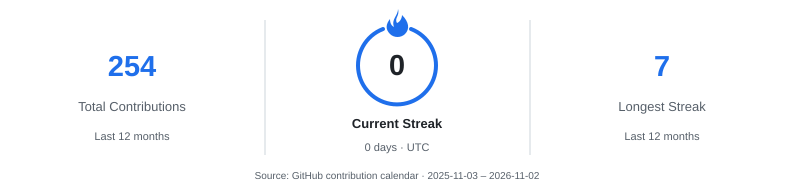
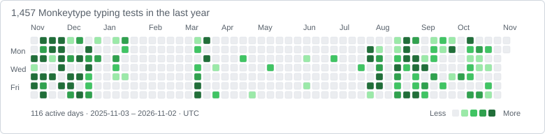

Software engineer focused on **C# and .NET backend development**. I build applications with clear structure, practical data access, and maintainable code.

[LinkedIn](https://www.linkedin.com/in/ziadmaghraby/) · [Email](mailto:ziadelmaghraby0@gmail.com) · [LeetCode](https://leetcode.com/u/ZiadMaghraby/) · [Codeforces](https://codeforces.com/profile/ZiadMaghraby) · [Monkeytype](https://monkeytype.com/profile/ZiadMaghraby)

[Projects](#featured-projects) &nbsp; / &nbsp; [Skills](#technical-skills) &nbsp; / &nbsp; [Activity](#activity)

 

### `ziad@github ~ $ whoami`

### Featured Projects

| Project | Stack | Overview |
| :--- | :--- | :--- |
| **[StockPilot](https://github.com/ZiadMaghraby/StockPilot)** | C# · ASP.NET Core · EF Core | Multi-tenant inventory and orders, transactional stock reservations, role-based access, and integration tests. |
| **[Clarity Clinic](https://github.com/ZiadMaghraby/clarity-clinic)** | PHP · Clinic management | Bilingual appointments, patient profiles, billing, reports, and audited doctor availability. |
| **[Noteforge](https://github.com/ZiadMaghraby/noteforge)** | C# · ASP.NET Core · Blazor · EF Core · SQLite | Workspace app with block editing, nested pages, and task databases. In development. |
| **[Clinic System](https://github.com/ZiadMaghraby/clinic_system)** | PHP · Laravel · MySQL | Collaborative clinic management for doctors, patients, appointments, and invoices. |
| **[Recipe App](https://github.com/ZiadMaghraby/recipeApp)** | Java · Android | Recipe browsing, favorites, custom recipes, and shopping lists. |
| **[Antique Shop](https://github.com/ZiadMaghraby/antique-shop-project)** | React · Bootstrap · Vite | Collaborative storefront with product browsing, cart, checkout flow, and theme switching. |
| **[Calculator](https://github.com/ZiadMaghraby/calculator)** | C# · .NET | Console calculator with input validation and safe arithmetic operations. |

[Explore all repositories →](https://github.com/ZiadMaghraby?tab=repositories)

### Technical skills

**Backend**  
.NET · MVC · REST APIs · LINQ · Entity Framework · Dapper · ADO.NET · Laravel / Eloquent · SQL / MySQL · NoSQL

**Frontend**  
HTML · CSS · React · React Router · Tailwind CSS · Bootstrap · styled-components · Alpine.js · Blade · Vite

**Mobile**  
Android

**Engineering & delivery**  
OOP · SOLID · Domain-Driven Design · Microservices · Testing · Azure · Git / GitHub · CI/CD

**Languages**  
C# · C++ · Java · PHP · JavaScript

### Activity

#### GitHub

<picture>
<source media="(prefers-color-scheme: dark)" srcset="https://raw.githubusercontent.com/ZiadMaghraby/ZiadMaghraby/main/activity-snapshots/github-dark-d92aab025d80.svg">

</picture>

#### [Monkeytype](https://monkeytype.com/profile/ZiadMaghraby)

<picture>
<source media="(prefers-color-scheme: dark)" srcset="https://raw.githubusercontent.com/ZiadMaghraby/ZiadMaghraby/main/activity-snapshots/monkeytype-dark-80cab1812e8e.svg">

</picture>

About the animated profile

The terminal portrait and contribution heatmap are self-contained SVGs stored in this repository. Animations play once and respect reduced-motion preferences. GitHub Actions refreshes the heatmap daily using GitHub’s contribution calendar; no external stats-image service is needed.

Design inspired by [Avi Vashishta’s animated profile guide](https://www.avivashishta.com/blog/build-animated-github-profile-readme).

---

[Get in touch](mailto:ziadelmaghraby0@gmail.com) · [LinkedIn](https://www.linkedin.com/in/ziadmaghraby/)
