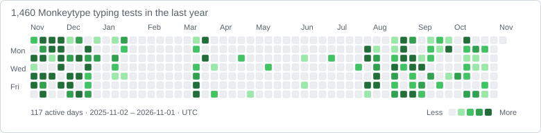

<picture>
  <source media="(prefers-color-scheme: dark)" srcset="assets/terminal/identity-dark.svg">
  
</picture>

[LinkedIn](https://www.linkedin.com/in/ziadmaghraby/) · [Email](mailto:ziadelmaghraby0@gmail.com) · [Projects](#selected-projects) · [Activity](#github-activity)

### Selected projects

| Project | What it does | Built with |
| :--- | :--- | :--- |
| **[StockPilot](https://github.com/ZiadMaghraby/StockPilot)** | Multi-tenant inventory and orders, transactional stock reservations, role-based access, and integration tests. | ASP.NET Core · EF Core |
| **[NoteForge](https://github.com/ZiadMaghraby/noteforge)** | A workspace with block editing, nested pages, and project databases. In development. | Blazor · SQLite |
| **[Clarity Clinic](https://github.com/ZiadMaghraby/clarity-clinic)** | Bilingual clinic management: appointments, patient profiles, billing, reports, and audited doctor availability. | PHP |

More projects

- **[Clinic System](https://github.com/ZiadMaghraby/clinic_system)** — Collaborative Laravel/MySQL app for doctors, patients, appointments, and invoices.
- **[Recipe App](https://github.com/ZiadMaghraby/recipeApp)** — Java/Android app with favorites, custom recipes, and shopping lists.
- **[Antique Shop](https://github.com/ZiadMaghraby/antique-shop-project)** — Collaborative React storefront with a cart, checkout flow, and theme switching.
- **[Calculator](https://github.com/ZiadMaghraby/calculator)** — C# console app with input validation and safe arithmetic.

[All repositories →](https://github.com/ZiadMaghraby?tab=repositories)

### Toolbox

| Area | Technologies & practices |
| :--- | :--- |
| **Core** | C# · ASP.NET Core · REST APIs · LINQ |
| **Data** | Entity Framework Core · Dapper · ADO.NET · SQL / MySQL |
| **Web & mobile** | React · Blazor · Laravel · Android |
| **Engineering** | OOP · SOLID · Domain-Driven Design · Testing · Git · CI/CD |

### GitHub activity

<picture>
  <source media="(prefers-color-scheme: dark)" srcset="assets/terminal/contributions-dark.svg">
  
</picture>

Beyond projects · problem solving & typing

[LeetCode](https://leetcode.com/u/ZiadMaghraby/) · [Codeforces](https://codeforces.com/profile/ZiadMaghraby) · [Monkeytype](https://monkeytype.com/profile/ZiadMaghraby)

<picture>
  <source media="(prefers-color-scheme: dark)" srcset="activity-monkeytype-dark.svg">
  
</picture>

